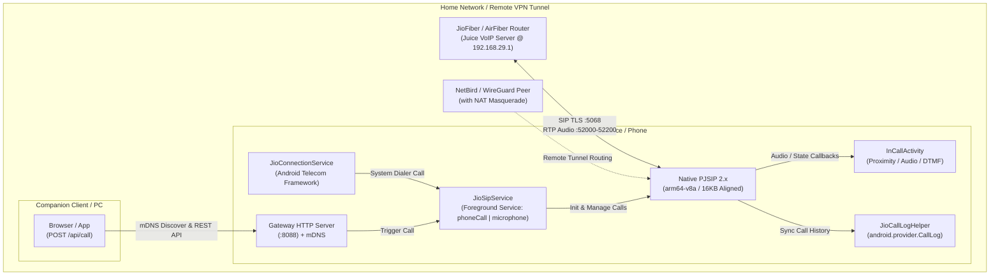

# Jio Landline Calling Appliance & Remote Gateway

[%20to%2017+-3DDC84.svg?logo=android&logoColor=white)](https://developer.android.com)
[](https://developer.android.com/about/dashboards)
[](https://developer.android.com/ndk)
[-success.svg)](https://developer.android.com/guide/practices/page-sizes)
[](https://www.pjsip.org/)
[](#disclaimer)

An open-source Android application designed to repurpose any spare or older Android smartphone into a **dedicated, always-on landline phone and remote calling gateway** for **Reliance JioFiber and AirFiber** connections. Also functions seamlessly as a secondary calling account directly inside the stock dialer on modern Android devices (Android 6.0 to Android 17+).

---

## Table of Contents
- [Motivation & Problem Statement](#motivation--problem-statement)
- [Key Features](#key-features)
- [System Architecture](#system-architecture)
- [Jio IMS Protocol & Quirks](#jio-ims-protocol--quirks)
- [Remote Gateway REST API](#remote-gateway-rest-api)
- [VPN & Remote Tunnel Routing (NetBird / WireGuard)](#vpn--remote-tunnel-routing-netbird--wireguard)
- [Project Structure](#project-structure)
- [Hardware & Software Requirements](#hardware--software-requirements)
- [Building from Source](#building-from-source)
- [Installation & First-Time Setup](#installation--first-time-setup)
- [Automated Releases & CI/CD](#automated-releases--cicd)
- [Troubleshooting & FAQ](#troubleshooting--faq)
- [Security & Privacy](#security--privacy)
- [Credits & Acknowledgements](#credits--acknowledgements)
- [Disclaimer](#disclaimer)

---

## Motivation & Problem Statement

Reliance Jio provides landline calling over home fiber/fixed-wireless connections via their official **JioJoin** (formerly JioCall) application. However, using the official app comes with several challenges:

1. **Deprecated on Older Hardware**: The official app drops support for older Android versions, turning perfectly usable phones into e-waste.
2. **Aggressive Battery Drain & Sluggishness**: Built with heavy cross-platform frameworks, consuming 150MB–250MB+ of RAM and frequently crashing in the background.
3. **Flaky Background Registration**: Aggressive modern Android battery management frequently kills the background service, leading to missed landline calls.
4. **No Native Hardware Feel**: Cannot hook into the phone's native system dialer on modern Android or sync directly with the native Android call log.
5. **No Remote Calling**: Cannot use your home fixed-line landline number when away from home over a VPN or remote companion devices.

### The Solution
This project implements a lightweight, native C++ **PJSIP (Pjsua2)** SIP stack paired with an ultra-efficient Android background service:
* Supports **Android 4.4 KitKat (API 19)** all the way through **Android 17+ (API 34+)**.
* Compiled with **16 KB page-size ELF alignment** (`p_align = 0x4000`) for Android 15/16/17 devices.
* Memory footprint of just **~25MB–35MB RAM**.
* Auto-starts on boot to operate 24/7 as an unkillable home landline appliance.
* Native **Android Telecom Framework (`ConnectionService`)** integration for stock dialer account selection.
* Exposes a built-in **HTTP REST API & mDNS discovery** so companion devices on the network can trigger landline calls remotely without audio bridging.
* Dynamic tunnel routing allowing calling over **NetBird, WireGuard, or Tailscale** home tunnels.

---

## Key Features

* **Zero-Touch Provisioning (Zero-OTP)**:
  * Discovers the Jio router automatically on the local network (`192.168.29.1`).
  * Simulates a Jio Set-Top Box (`nwk_intf=eth`) on port `8443` to retrieve SIP authentication credentials instantly with **no SMS OTP required**.
  * Also supports Permanent Wi-Fi mode (`nwk_intf=wifi`) with SMS OTP verification if required.
* **Dual Dialer Integration**:
  * **Android Telecom Framework (Android 6.0+)**: Registers as an official system calling account (`PhoneAccount`). Choose "Jio Landline" directly from the native Google/Samsung dialer or make it the default calling account.
  * **Stock Hardware Dialer Hook (Android < 6.0)**: Intercepts dialed numbers directly from legacy dialpads (`NEW_OUTGOING_CALL`), cancelling cellular radio attempts and routing calls through the landline.
* **High-Fidelity 2-Way Voice Pipeline**:
  * **AMR-NB (8,000 Hz, 12.2 kbps Mode 7)** prioritized at **255** to match Jio IMS fixed-line voice specifications and the 8000 Hz conference bridge without resampler distortion.
  * **AMR-WB (16,000 Hz, 23.85 kbps Mode 8)** wideband fallback.
  * Hardware acoustic echo cancellation via Android Audio HAL (`MODE_IN_COMMUNICATION`).
  * Microphone capture amplification (+3.5 dB boost) for crisp outbound voice.
  * Full Android 14+ foreground service microphone compliance (`FOREGROUND_SERVICE_MICROPHONE`).
* **16 KB Memory Page-Size Alignment**:
  * Both 64-bit native libraries (`libpjsua2.so` and `libc++_shared.so` under `arm64-v8a`) are linked with `-Wl,-z,max-page-size=16384`.
  * Verified for Android 15, Android 16, and Android 17 devices and emulators.
* **VPN & Remote Tunnel Routing**:
  * Dynamic kernel routing discovery (UDP connect routing probe) resolves local IP dynamically across Wi-Fi, Ethernet, and VPN tunnel interfaces (`wt*`, `tun*`, `vpn*`).
  * Media sockets bound to `INADDR_ANY` (`0.0.0.0`), preventing `EADDRNOTAVAIL` socket errors when connected through NetBird, WireGuard, or Tailscale.
* **Always-On Appliance Reliability**:
  * Autostarts on device boot (`RECEIVE_BOOT_COMPLETED`).
  * Maintains continuous Wi-Fi connection and CPU keepalive using `WifiLock` (High-Perf) and `WakeLock`.
  * Automatic SIP re-registration with aggressive NAT keepalive timers.
* **Native System Call Log Integration**:
  * Automatically records incoming, outgoing, and missed calls directly into Android's native `CallLog.Calls` database.
* **Remote Gateway Server (Port 8088)**:
  * Zero-dependency HTTP server with CORS support.
  * Advertises via native mDNS (`_jiolandline._tcp.`).
  * Allows companion devices (Device B) to pair via a 4-digit PIN, check battery/network status, and trigger outgoing calls.
* **Custom Overlay In-Call UI**:
  * Screen wakes and displays over lock screen (`FLAG_SHOW_WHEN_LOCKED`, `FLAG_TURN_SCREEN_ON`).
  * Controls: Speakerphone toggle, microphone mute, in-call DTMF dialpad, and chronometer.
  * Proximity sensor integration turns the screen off when held to the ear.

---

## System Architecture



---

## Jio IMS Protocol & Quirks

Connecting to a JioFiber ONT requires handling specific proprietary quirks implemented in the router's internal VoIP daemon (the **Juice Server**):

### 1. Router Endpoints
* **HTTP `8080` (`/request_account`)**: Returns account metadata in JSON format containing `msisdn` (landline number), `imsi`, `mcc` (405), `mnc` (874), and line status.
* **HTTPS `8443` (`/`)**: Credentials distribution service. Uses legacy self-signed certificates and older SSL/TLS ciphers.
* **SIP TLS `5068`**: Internal SIP proxy routing directly to Jio's IMS core (`wb.wln.ims.jio.com`).
* **RTP Ports `52000–52200`**: Standard JioFiber RTP port range allowed through the ONT firewall.

### 2. Zero-OTP Ethernet Mode Bypass (`nwk_intf=eth`)
Normally, Wi-Fi requests (`nwk_intf=wifi`) trigger an SMS OTP to the registered mobile number. Simulating a wired Jio Set-Top Box by passing `nwk_intf=eth` causes the Juice server to **completely bypass OTP verification**, returning the XML provisioning document (`wap-provisioningdoc`) containing the SIP username, password, realm, and outbound proxy immediately.

### 3. Virtual MAC & Instance UUID Calculation
The router validates that requests originate from an authorized virtual MAC. The MAC is deterministically derived from the client's device hostname using DJB2 hashing:

```java
int h = 0;
for (byte b : hostname.getBytes("UTF-8")) {
    h = ((h * 33) + b) & 0xFFFFFFFF;
}
byte b0 = (byte) (h & 0xFF);
byte b1 = (byte) ((h >> 8) & 0xFF);
byte b2 = (byte) ((h >> 16) & 0xFF);
byte b3 = (byte) ((h >> 24) & 0xFF);

String mac = String.format("00:00:%02x:%02x:%02x:%02x", b0, b1, b2, b3);
String uuid = String.format("00000000-0000-1000-8000-0000%02X%02X%02X%02X", b0, b1, b2, b3);
```

### 4. Non-Standard `+sip.instance` Header
* Standard RFC 5626 format: `+sip.instance="<urn:uuid:00000000-...>"`
* **Jio Juice requirement**: The router strictly rejects `urn:uuid:` with `401 Unauthorized`. It requires:
  ```http
  +sip.instance="<00000000-0000-1000-8000-0000AABBCCDD>"
  ```
  This must be present on **all** `REGISTER` and `INVITE` contact headers.

### 5. Mandatory Audio Codecs & FMTP Settings
Jio's core network rejects or silences standard G.711 PCMA/PCMU audio after ~30 seconds. Outgoing calls must negotiate OpenCORE AMR:
* **AMR-NB (8000 Hz)**: Configured at 12.2 kbps (Mode 7) with `octet-align=1`, `mode-set=0,1,2,3,4,5,6,7`.
* **AMR-WB (16000 Hz)**: Configured at 23.85 kbps (Mode 8) with `octet-align=1`.

---

## Remote Gateway REST API

When running as an appliance, the app exposes an HTTP REST API on port `8088` and advertises itself via Android mDNS (`_jiolandline._tcp`).

### 1. Discovery (`mDNS`)
* **Service Type**: `_jiolandline._tcp.`
* **Service Name**: `JioLandline-Gateway`
* **Port**: `8088`
* **Attributes**: `version=1.0`, `device=<Manufacturer> <Model>`

### 2. Endpoints

#### `GET /api/status`
Returns real-time gateway status, battery, and call state. No authentication required.
```json
{
  "status": "IDLE",
  "registered": true,
  "msisdn": "+91XXXXXXXXXX",
  "activeCallNumber": null,
  "batteryLevel": 98,
  "isCharging": true,
  "wifiSsid": "MyJioFiber_5G",
  "deviceModel": "Pixel 7 Pro",
  "port": 8088,
  "pairedDevices": 1,
  "timestamp": 1731600000000
}
```

#### `POST /api/pair`
Pairs a new companion client using the 4-digit PIN displayed on the gateway screen.
```json
// Request
{
  "pin": "4821",
  "clientName": "Work Laptop"
}

// Response (200 OK)
{
  "status": "PAIRED",
  "token": "d8f3a9e14c2b...",
  "msisdn": "+91XXXXXXXXXX",
  "deviceModel": "Pixel 7 Pro"
}
```

#### `POST /api/call`
Initiates an outbound landline call. Requires `Authorization` header.
```json
// Headers: Authorization: "Bearer <token>"
// Request
{
  "number": "+919876543210"
}

// Response (200 OK)
{
  "status": "CALLING",
  "number": "+919876543210"
}
```

#### `POST /api/hangup`
Terminates the active landline call. Requires `Authorization` header.
```json
// Headers: Authorization: "Bearer <token>"
// Response (200 OK)
{
  "status": "HANGUP_REQUESTED"
}
```

---

## VPN & Remote Tunnel Routing (NetBird / WireGuard)

You can place and receive Jio Landline calls even when outside your home by connecting your phone to your home network via a **NetBird, WireGuard, or Tailscale** tunnel:

1. **Routing Peer Configuration**:
   Ensure your home routing peer advertises the router subnet (`192.168.29.0/24`) with **NAT Masquerade (SNAT)** enabled:
   ```bash
   # NetBird routing peer with masquerade:
   netbird up --network-route 192.168.29.0/24 --masquerade
   ```
2. **App Auto-Detection**:
   The app uses a kernel UDP routing probe to detect the active interface (`wt0`, `tun0`) and automatically uses the tunnel IP in SIP signaling while binding RTP sockets to `0.0.0.0` (`INADDR_ANY`).
3. **Wi-Fi Switching Guard**:
   When connected over a VPN tunnel, the app recognizes the active connection and automatically disables local Wi-Fi auto-switching.

---

## Project Structure

```
android-app/
├── .github/
│   └── workflows/
│       └── release.yml           # Automated release workflow with dynamic minor versioning
├── app/
│   ├── build.gradle              # Android build configuration (minSdk 19, targetSdk 34)
│   └── src/main/
│       ├── AndroidManifest.xml   # Permissions (phoneCall, microphone), activities, services
│       ├── jniLibs/              # 16KB-aligned compiled PJSIP native binaries
│       │   ├── arm64-v8a/        # libpjsua2.so, libc++_shared.so (64-bit ARM, 16KB aligned)
│       │   ├── armeabi-v7a/      # libpjsua2.so, libc++_shared.so (32-bit ARM)
│       │   └── x86/              # libpjsua2.so, libc++_shared.so (x86 Emulator/devices)
│       ├── java/com/jio/calling/
│       │   ├── audio/            # JioAudioManager: Speaker, Mute, Proximity sensor lock
│       │   ├── gateway/          # GatewayServer: HTTP server (:8088), Auth & mDNS
│       │   ├── model/            # JioAccount, RouterInfo data models
│       │   ├── provisioning/     # Zero-OTP STB bypass, router discovery, TLS factory
│       │   ├── receiver/         # OutgoingCallReceiver (legacy hook), BootReceiver
│       │   ├── service/          # JioSipService (Foreground service: phoneCall | microphone)
│       │   ├── sip/              # JioSipManager (PJSIP lifecycle, AMR codec tuning, UDP probe)
│       │   ├── telecom/          # JioTelecomManager, JioConnectionService (System dialer)
│       │   ├── ui/               # MainActivity, InCallActivity, IncomingCallActivity
│       │   └── util/             # JioCallLogHelper (Android native CallLog sync)
│       └── res/                  # Layouts, drawables, colors, styles
├── build.gradle                  # Top-level build script (AGP 8.2.2)
├── release.keystore               # Release signing keystore
└── settings.gradle               # Gradle project settings
```

---

## Hardware & Software Requirements

| Requirement | Minimum Specification | Recommended |
|---|---|---|
| **Android OS** | Android 4.4 KitKat (API 19) | Android 6.0 to Android 17+ |
| **Processor Architecture** | `arm64-v8a`, `armeabi-v7a`, or `x86` | 64-bit ARM (`arm64-v8a`) |
| **Page Size Support** | 4 KB or 16 KB pages | 16 KB aligned (`0x4000`) |
| **RAM** | 512 MB | 1 GB or more |
| **Network** | Home Wi-Fi or VPN tunnel | 5 GHz Wi-Fi or NetBird tunnel |
| **Router** | JioFiber ONT / Jio AirFiber Gateway | Voice service enabled on subscription |

---

## Building from Source

### 1. Prerequisites
* **Android SDK**: Build Tools `34.0.0` or higher.
* **JDK**: OpenJDK 17.
* **Prebuilt Native Binaries**: Included in `app/src/main/jniLibs/` with 16 KB page alignment for `arm64-v8a`.

### 2. Build Debug APK
```bash
cd android-app
./gradlew assembleDebug
```
Output APK: `app/build/outputs/apk/debug/app-debug.apk`

### 3. Build Signed Release APK
```bash
cd android-app
./gradlew assembleRelease
```
Output APK: `app/build/outputs/apk/release/app-release.apk`

---

## Installation & First-Time Setup

1. **Install APK**:
   Download the latest `jio-landline-v1.0.<build>.apk` from [GitHub Releases](https://github.com/) or install via ADB:
   ```bash
   adb install -r app-release.apk
   ```
   > **Note**: If you previously installed a debug build, **uninstall the debug version first** before installing the release APK (due to Android signature conflict).

2. **Connect to Network**:
   Connect to your home JioFiber / AirFiber Wi-Fi network (or activate your NetBird tunnel).

3. **Launch the App**:
   * Open **Jio Landline**.
   * Grant requested permissions (**Microphone**, Phone, Call Log).
   * The app will auto-discover the router at `192.168.29.1` and perform Zero-OTP STB provisioning.
   * Your landline number (`msisdn`) will appear on the dashboard with status **Registered (200 OK)**.

4. **Enable System Calling Account (Android 6.0+)**:
   * Open the app and toggle **Enable Calling Account (Telecom)**.
   * Tap **Open System Calling Accounts** and switch on **Jio Landline**.
   * You can now place calls using your landline number directly from your phone's stock Phone/Contacts app.

---

## Automated Releases & CI/CD

The repository includes a GitHub Actions workflow (`.github/workflows/release.yml`) that triggers on every push to `main`:
* Extracts base version from `app/build.gradle` and automatically updates the build version: `1.0.<github.run_number>` (e.g., `v1.0.1`, `v1.0.2`, `v1.0.3`).
* Updates `versionCode` and `versionName` directly in `app/build.gradle` so the compiled APK contains matching version metadata.
* Compiles and signs the release APK with `release.keystore`.
* Automatically tags the commit, creates a GitHub Release, and publishes `jio-landline-v1.0.<build_number>.apk`.

---

## Troubleshooting & FAQ

#### Q: App fails to install with "App not installed as package conflicts with an existing package".
* You have a debug version of the app installed. Completely uninstall the previous app before installing the release APK.

#### Q: The other party cannot hear me (one-way audio).
* **Release APK on Android 14+**: Ensure the app has granted the **Microphone** (`RECORD_AUDIO`) permission. Android 14+ silences microphone capture for foreground services if permission is not granted.
* **Codec negotiation**: The app automatically prioritizes AMR-NB (12.2 kbps, 8000 Hz) to match Jio ONT fixed-line voice requirements.

#### Q: The app displays a warning about 16 KB alignment on Android 15/16/17.
* Re-download the latest release build. Both `libc++_shared.so` and `libpjsua2.so` for `arm64-v8a` are verified and aligned to 16 KB (`0x4000`) boundaries.

#### Q: Registration fails with `401 Unauthorized` or "Router not reachable".
* Ensure you are connected to the primary Wi-Fi network of your JioFiber router (not a guest network or isolated sub-router).
* Verify that voice service is active on your JioFiber subscription.
* Test router reachability by opening `http://192.168.29.1:8080/request_account` in your phone's browser.

#### Q: Calls drop immediately when calling over VPN / NetBird.
* Verify that your home routing peer has **NAT Masquerade** enabled (`--masquerade`). The ONT router needs return packets to be SNAT'd to the routing peer's local subnet IP.

---

## Security & Privacy

* **100% Local & Private**: No analytics, telemetry, or external cloud servers. All communication is strictly confined to your local network or your private VPN tunnel.
* **Encrypted SIP**: SIP signaling to the ONT is TLS-encrypted on port `5068`.
* **PIN-Protected API**: Remote trigger endpoints (`/api/call`, `/api/hangup`) require authentication via a 4-digit PIN displayed on the device screen.

---

## Credits & Acknowledgements

* **[PJSIP / Teluu](https://www.pjsip.org/)**: For the open-source multimedia communication library and `pjsua2` framework.
* **[JFC-Group](https://github.com/JFC-Group)**: For reverse-engineering research on the router's Juice server protocol and Zero-OTP bypass techniques.
* **[JFC-RusTone](https://github.com/JFC-Group/JFC-RusTone)**: For reference implementations of Jio SIP instance headers.

---

## Disclaimer

This is an independent open-source research and home automation project developed for educational and accessibility purposes. It is **not** an official product of, nor is it endorsed, sponsored, or affiliated with **Reliance Jio Infocomm Ltd.** "Jio", "JioFiber", "AirFiber", and related trademarks are the property of their respective owners.
